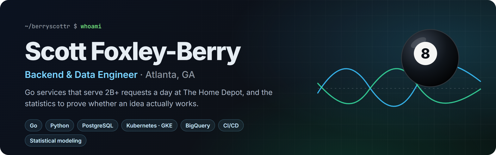
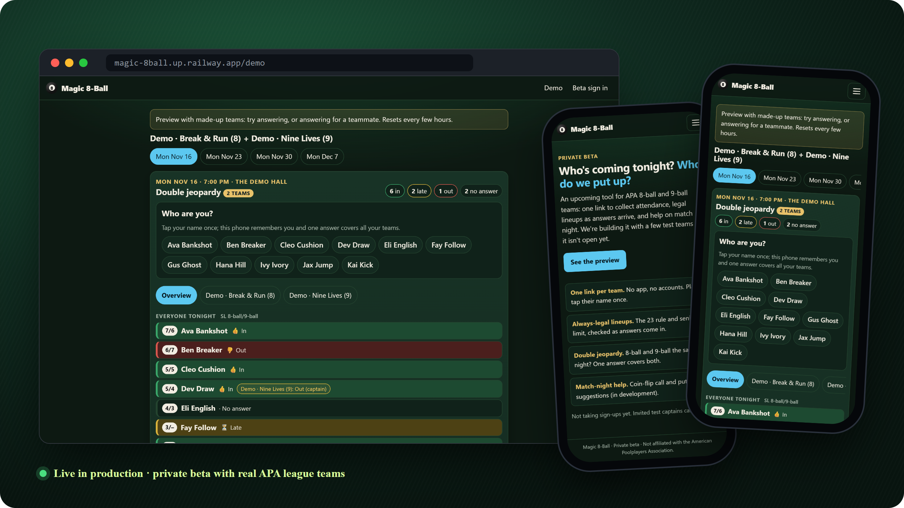
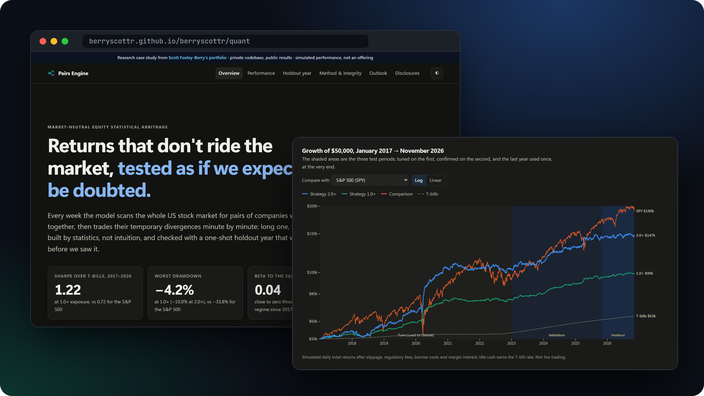

  
  
  
  

<i>Hello there.</i> I build backend systems that stay up and data work that holds up under scrutiny.

|  |  |  |  |
|:---:|:---:|:---:|:---:|
| **8 years** backend, data & platform engineering | **2B+ requests/day** across 4,000+ services at The Home Depot | **M.S. Data Science** Indiana University · ML & cybersecurity | **B.S. Industrial Eng.** Georgia Tech · best senior design project |

---

## 🚀 Featured work

Both flagship projects are private repos. Each one has a public demo you can open right now.

### 🎱 Magic 8-Ball: match-night app for APA pool league teams

  
  
  
  
  
  
  

Captains share one link per team. Players tap their name once, answer In, Late, or Out, and see a legal lineup form as answers arrive. One answer covers every team a player has that night. Captains sign in with their APA account to get the full board, opponent rosters, and match-night strategy tools. Rosters, skill levels, and schedules sync from the APA every 15 minutes.

- **Production service, owned end to end:** a single Go binary that runs the web app, the background APA sync, and the demo, backed by Postgres with embedded migrations. It deploys to Railway with separate dev and production environments.
- **Built to be safe on the public internet:** captains sign in with APA credentials, but passwords are never stored. Session tokens are kept only as hashes. The app uses a strict CSP with no inline script, same-origin checks on every write, per-IP rate limits, and parameterized SQL only.
- **CI is the deploy gate:** gofmt, vet, staticcheck, race-enabled tests against a real Postgres with a coverage floor, govulncheck, a Docker build, and a headless-Chrome smoke test. Railway deploys only after CI passes, and CI also enforces the branching policy.
- **Evolved, not rewritten:** it started in 2022 as a Python Discord bot and became a Go web app. The original formulas were ported and parity-tested against the old outputs, and the image shrank from Python + Chromium to a ~29 MB distroless binary. 21 architecture decision records document why things are the way they are.

### 📈 Pairs Engine: market-neutral statistical-arbitrage research platform

  
  
  
  
  
  

Every week the engine scans 1,000 to 3,000 liquid US stocks for pairs whose prices are cointegrated. It trades their temporary divergences in a minute-bar simulator with realistic costs. Above all, it's an exercise in **not fooling yourself** with a backtest.

- **Whole-market discovery:** vectorized Engle-Granger and ADF tests, verified against statsmodels, run over the market every week. Data comes from Alpaca (SIP minute bars) and SEC EDGAR, stored in Parquet with resumable, validated ingest.
- **Honest validation:** a walk-forward design with no look-ahead (fills land on the next bar), a tune / validation / holdout split, and a trial ledger covering all **4,699 configurations** tried. That ledger feeds a Deflated Sharpe ratio and the probability of backtest overfitting (PBO). Parameters were chosen as interior points of profitable plateaus, never as the single best point.
- **A pre-registered holdout, reported straight:** the final year was read once, against pass bands committed in advance. The result (excess Sharpe 0.16, "weak but positive") is published as-is, not tuned away.
- **Engineering discipline:** results are bit-identical for any worker count, invariant checks run on every result path, every known pitfall has a guard and a test (140+ tests), and every derived artifact carries a provenance fingerprint.

Simulated research results, not live trading or an offering. The codebase is private; the results site shows aggregates only.

---

## 🏢 At The Home Depot (Systems Engineer II · 2020 to present)

| Project | What I built |
|---|---|
| **Watchdog** | A production Go service that decides traffic advertisement and health validation for thousands of services, using rule-based and anomaly-detection health evaluation. It exposes REST/OpenAPI endpoints and Prometheus metrics. |
| **Bifrost Bot** | A Go Slack app on GKE that automates infrastructure promotions, health reporting, documentation discovery, and escalations. |
| **Infra validation** | A centralized smoke-testing platform (Go, Python, GitHub Actions) that checks deployment readiness, certificate expiry, and documentation quality. |
| **Migration ETL** | Python and BigQuery pipelines that use NLP and ML to classify service ownership and drive a proxy-architecture migration. |

Earlier: Implementation Engineer at <b>Featurespace</b> (fraud-detection platforms on AWS with Kafka, Elasticsearch, and MongoDB) and at <b>Noble Systems</b> (PostgreSQL, Linux, deployment automation). Full details in the <a href="resume/RESUME.md">resume</a>.

## 🧰 Toolbox

   
  

**Also:** BigQuery · Spark · Hadoop · OpenAPI · htmx · polars · numba · statsmodels · NLP · ML classification · time-series statistics · integer programming · AI-assisted engineering (agent-ready repos with per-package guides and project skills)

## 🗂️ More projects

| Project | About |
|---|---|
| [apa-rankings](https://github.com/berryscottr/apa-rankings) | Classification models that predict APA match results. This was the seed of Magic 8-Ball. |
| [nfl_ref_sentiment](https://github.com/berryscottr/nfl_ref_sentiment) | Reddit game-thread NLP: how win-probability swings change sentiment toward referees. |
| [palantir](https://github.com/berryscottr/palantir) | A Lord of the Rings chatbot trained on the books. |
| [DataVisualization](https://github.com/berryscottr/DataVisualization/blob/main/spotify.ipynb) | Visual analysis of my Spotify streaming history. |
| [Go-Thats-A-Baseball](https://github.com/berryscottr/Go-Thats-A-Baseball) | Machine learning in Go, aimed at beating Vegas MLB lines. |
| [cfb-rankings-superleague-edition](https://github.com/berryscottr/cfb-rankings-superleague-edition) | "The definitive CFB rankings." |
| [pure-pazaak](https://github.com/berryscottr/pure-pazaak) | The Pazaak card game, written in Rust. |

Atlanta, GA · swimmer, billiards team captain, Trees Atlanta volunteer

